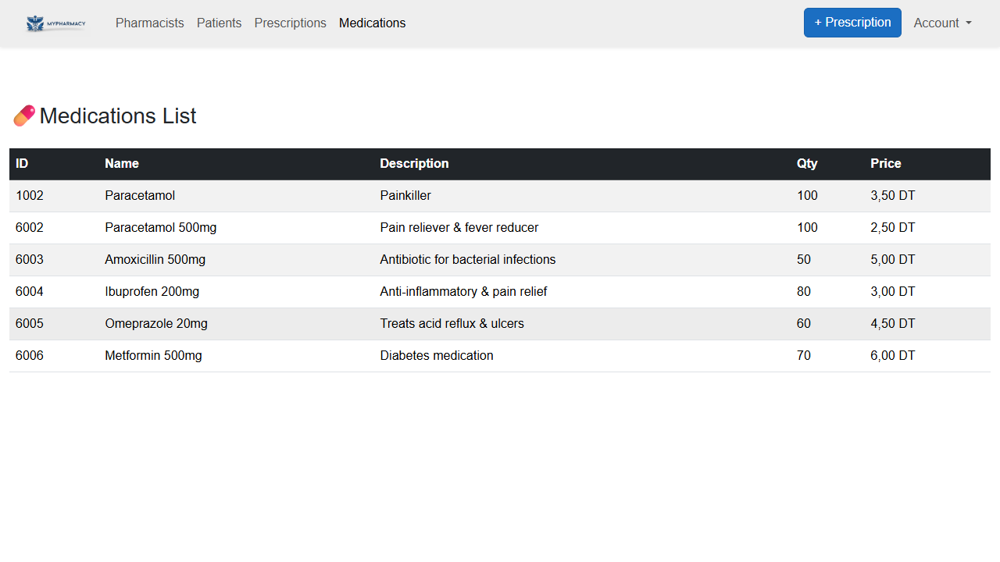
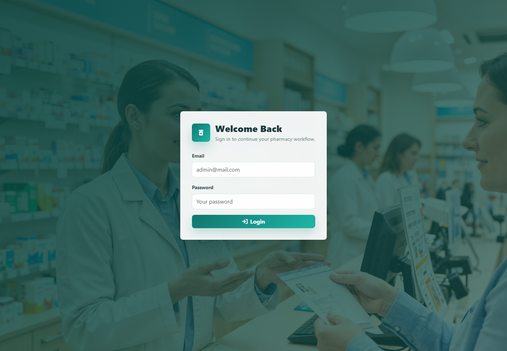
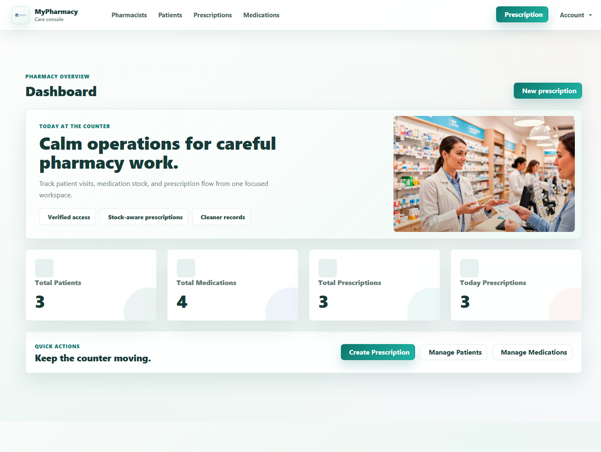
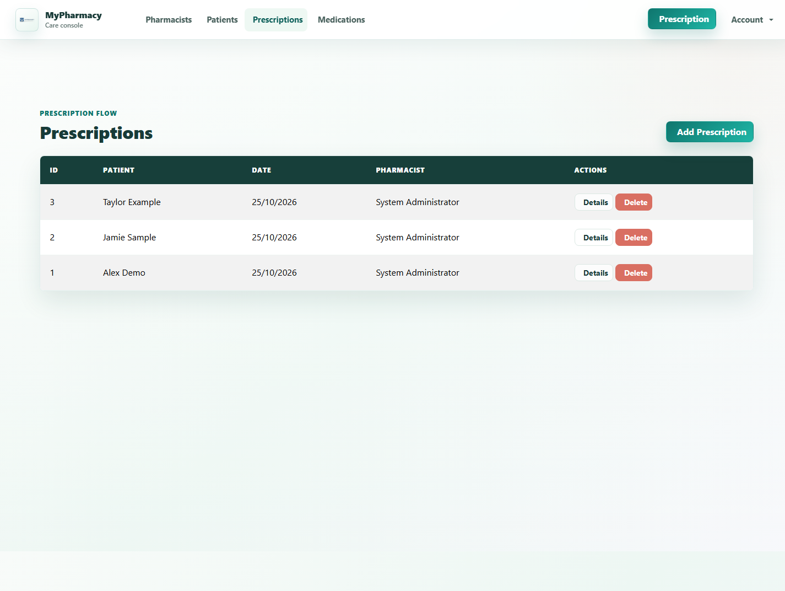

# 💊 MyPharmacy

[](https://dotnet.microsoft.com/)
[](https://dotnet.microsoft.com/apps/aspnet/web-apps/blazor)
[](https://www.microsoft.com/sql-server)
[](https://learn.microsoft.com/ef/core/)
[](https://github.com/smidamanar/MyPharmacy/actions/workflows/build.yml)
[](LICENSE)

[Features](#-features) · [Architecture](#%EF%B8%8F-architecture) · [Installation](#-installation) · [Security](#-security) · [Author](#-author)

**Full-stack pharmacy operations platform**

MyPharmacy is a web application built with **ASP.NET Core**, **Blazor WebAssembly**, **Entity Framework Core**, and **SQL Server**. It gives pharmacy teams a focused workspace to manage patients, medication inventory, prescriptions, staff accounts, and day-to-day dashboard metrics.



| Login | Dashboard | Prescriptions |
| --- | --- | --- |
|  |  |  |

> This project is a learning and portfolio application. Do not use it to store real patient data until it has completed the security, privacy, compliance, auditing, and operational work required in your jurisdiction.

---

## ✨ Overview

MyPharmacy uses a layered architecture that separates the Blazor WebAssembly client, API controllers, application services, and SQL Server persistence.

---

# 🚀 Features

- JWT-based authentication with `Admin` and `Pharmacist` roles
- Pharmacist, patient, and medication management
- Inventory-aware prescription create, edit, and delete workflows
- Transactional stock adjustments and optimistic-concurrency protection
- Role-scoped prescription access
- Dashboard totals and low-stock indicator
- Responsive Blazor WebAssembly interface and PWA support

## 🛠️ Technology stack

| Area | Technology |
| --- | --- |
| Backend | ASP.NET Core 9, EF Core 9, JWT Bearer authentication |
| Frontend | Blazor WebAssembly, Bootstrap, Blazored LocalStorage |
| Database | SQL Server / SQL Server LocalDB |
| Testing | Playwright, Selenium, Robot Framework |

---

# 🏗️ Architecture

```text
Browser
   │ HTTPS / JSON / JWT
   ▼
Blazor WebAssembly client
   │
   ▼
ASP.NET Core API controllers
   │
   ▼
Application services
   ├── Patient, medication, and pharmacist services
   │       └── Repository abstractions ─┐
   └── Prescription service ────────────┤
                                        ▼
                               AppDbContext / EF Core
                                        │
                                        ▼
                                   SQL Server
```

The patient, medication, and pharmacist services use repository abstractions. `PrescriptionService` accesses `AppDbContext` directly to keep prescription and stock changes within the same database transaction.

The solution contains an API project and a Blazor WebAssembly client under `src/`.

---

# 📂 Project structure

```text
MyPharmacy/
│
├── .env.example                 # Safe environment-variable reference
├── .gitignore
├── LICENSE
├── README.md
├── MyPharmacy.sln
│
├── src/
│   ├── MyPharmacy.Api/           # ASP.NET Core REST API
│   │   ├── Auth/                 # JWT configuration and token generation
│   │   ├── Controllers/          # API endpoints
│   │   ├── Data/                 # AppDbContext and bootstrap seeding
│   │   ├── DTOs/                 # Request/response contracts
│   │   ├── Migrations/           # EF Core schema history
│   │   ├── Models/               # Domain entities
│   │   ├── Repositories/         # Data-access abstractions
│   │   └── Services/             # Business workflows and validation
│   └── MyPharmacy.Client/        # Blazor WebAssembly client
│       ├── Layout/
│       ├── Models/
│       ├── Pages/
│       ├── Services/
│       ├── Shared/
│       └── wwwroot/
│
├── tests/
│   └── MyPharmacy.Tests.E2E/     # Playwright, Selenium, Robot Framework tests
└── docs/                         # Architecture notes and curated screenshots
```

---

# ⚙️ Installation

## Prerequisites

- .NET SDK 9.0+
- SQL Server LocalDB (or another SQL Server instance)
- EF Core CLI: `dotnet tool install --global dotnet-ef`
- For HTTPS launch profiles on a fresh development machine: `dotnet dev-certs https --trust`

## 1. Clone the repository

   ```powershell
   git clone https://github.com/smidamanar/MyPharmacy.git
   cd MyPharmacy
   ```

## 2. Configure local secrets

Copy `.env.example` only as a reference. For local .NET development, use User Secrets rather than committing a real `.env` file.

   ```powershell
   cd src/MyPharmacy.Api
   dotnet user-secrets init
   dotnet user-secrets set "JwtSettings:Key" "replace-with-a-long-random-development-secret"
   dotnet user-secrets set "BootstrapAdmin:Email" "admin@example.com"
   dotnet user-secrets set "BootstrapAdmin:Password" "ChangeThisAdminPassword123!"
   cd ..
   ```

## 3. Configure the database

Configure `src/MyPharmacy.Api/appsettings.Development.json` with a local SQL Server connection string if LocalDB is not appropriate for your machine.

## 4. Create the tables

```powershell
cd src/MyPharmacy.Api
dotnet ef database update
cd ..
```

## 5. Run the application

Run the API and frontend in separate terminals.

   ```powershell
   dotnet run --project src/MyPharmacy.Api/MyPharmacy.Api.csproj --launch-profile https
   ```

   ```powershell
   dotnet run --project src/MyPharmacy.Client/MyPharmacy.Client.csproj --launch-profile https
   ```

Open:

   - Frontend: `https://localhost:7063`
   - Swagger: `https://localhost:7230/swagger`

The bootstrap administrator is created only when both `BootstrapAdmin:Email` and `BootstrapAdmin:Password` are supplied. Remove the bootstrap password secret after creating your first administrator.

---

# ⚙️ Configuration

| Setting | Required | Purpose |
| --- | --- | --- |
| `ConnectionStrings:DefaultConnection` | Yes | SQL Server connection string |
| `JwtSettings:Key` | Yes | Long, random JWT signing key |
| `JwtSettings:Issuer` | Yes | JWT issuer |
| `JwtSettings:Audience` | Yes | JWT audience |
| `BootstrapAdmin:Email` | First run only | First administrator email |
| `BootstrapAdmin:Password` | First run only | First administrator password |
| `Cors:AllowedOrigins` | Production | Allowed frontend origins |

Never commit real passwords, JWT keys, database credentials, connection strings containing passwords, certificates, or production configuration.

---

# 🔌 API overview

| Area | Route prefix |
| --- | --- |
| Authentication | `/api/Auth` |
| Pharmacists | `/api/Pharmacist` |
| Patients | `/api/Patient` |
| Medications | `/api/Medication` |
| Prescriptions | `/api/Prescription` |
| Dashboard | `/api/Dashboard` |

Swagger is enabled in the Development environment.

---

# 🧪 Testing and development

```powershell
# Build the active solution
dotnet build MyPharmacy.sln

# Apply migrations
dotnet ef database update --project src/MyPharmacy.Api/MyPharmacy.Api.csproj

# Create a migration
dotnet ef migrations add <MigrationName> --project src/MyPharmacy.Api/MyPharmacy.Api.csproj

# Run the browser automation suites (with the API and client already running)
pip install -r tests/MyPharmacy.Tests.E2E/PlaywrightTests/requirements.txt
pytest tests/MyPharmacy.Tests.E2E/PlaywrightTests

# Alternative Robot Framework suite
pip install -r tests/MyPharmacy.Tests.E2E/RobotTests/requirements.txt
robot tests/MyPharmacy.Tests.E2E/RobotTests/tests
```

---

# 🔒 Security

- Passwords are stored using BCrypt hashes.
- JWT keys must come from user secrets, environment variables, or a managed secret store.
- Prescription changes run in database transactions and protect medication stock from conflicting updates.
- The browser application currently stores JWTs in local storage. For production, replace this with secure HttpOnly cookies or a Backend-for-Frontend pattern.

---

# 🤝 Repository conventions

- Keep uncurated screenshots, logs, generated files, local databases, secrets, and reports out of Git.
- Add a migration whenever the EF Core model changes.
- Do not edit generated migration designer files manually.
- Run `dotnet build MyPharmacy.sln` before opening a pull request.

---

# 🗺️ Future improvements

- Replace browser local-storage JWTs with secure HttpOnly cookies or a Backend-for-Frontend pattern.
- Add audit history and immutable medication stock-movement records.
- Add pagination, filtering, and search across patient, medication, and prescription screens.
- Add unit and API integration tests for prescription and inventory workflows.
- Add medication batch, barcode, expiry, and reorder-threshold tracking.
- Add printable prescription outputs and role-aware reporting.
- Add containerized development and production deployment configuration.

---

# 📄 License

Distributed under the [MIT License](LICENSE).

---

# 👩‍💻 Author

**Manar SMIDA**

Software Engineering Student  
Full-Stack Development • .NET • Blazor

[GitHub](https://github.com/smidamanar)
